# Конспект: Алгоритм Кнута-Морриса-Пратта (KMP)

**Алгоритм KMP** — это алгоритм поиска подстроки в строке, разработанный в 1977 году Дональдом Кнутом, Джеймсом Моррисом и Вaugn Праттом. Его главная особенность — **гарантированное линейное время работы** и отсутствие «откатов» указателя в тексте назад.

## 1. Строгое определение префикс-функции

Для строки $S$ длины $m$ префикс-функция $\pi$ — это массив длины $m$, где:

$$\pi[i] = \max_{0 \leq k \leq i} \{k : S[0..k-1] = S[i-k+1..i]\}$$

**Простыми словами:** $\pi[i]$ — это длина **наибольшего префикса** строки $S[0..i]$, который одновременно является **суффиксом** этой же подстроки.

**Важное ограничение:** Префикс должен быть **собственным** (не равным всей строке $S[0..i]$), поэтому $\pi[i] \leq i$.

### Пример расчета для паттерна `"ABABAC"`:
* `i=0, S[0..0] = "A"` -> совпадений префикса и суффикса нет -> **$\pi[0] = 0$**
* `i=1, S[0..1] = "AB"` -> нет -> **$\pi[1] = 0$**
* `i=2, S[0..2] = "ABA"` -> префикс `"A"` == суффикс `"A"` -> **$\pi[2] = 1$**
* `i=3, S[0..3] = "ABAB"` -> префикс `"AB"` == суффикс `"AB"` -> **$\pi[3] = 2$**
* `i=4, S[0..4] = "ABABA"` -> префикс `"ABA"` == суффикс `"ABA"` -> **$\pi[4] = 3$**
* `i=5, S[0..5] = "ABABAC"` -> нет -> **$\pi[5] = 0$**

**Итоговый массив:** `[0, 0, 1, 2, 3, 0]`

---

## 2. Рекуррентная формула вычисления

Ключевая идея KMP: **мы можем вычислить $\pi[i]$, используя уже известные значения $\pi[0], \pi[1], \dots, \pi[i-1]$**.

### Базовый случай:
$$\pi[0] = 0$$
*(Для строки из одного символа нет собственного префикса, равного суффиксу).*

### Рекуррентный переход от $\pi[i-1]$ к $\pi[i]$:

Пусть мы знаем $\pi[i-1] = j$. Это означает, что:
$$S[0..j-1] = S[i-j..i-1]$$

Теперь мы хотим вычислить $\pi[i]$. Рассмотрим два случая:

#### **Случай 1: $S[i] = S[j]$**
Если новый символ $S[i]$ совпадает с символом $S[j]$ (который следует за префиксом), то мы можем **расширить** префикс на 1:
$$\pi[i] = j + 1$$

**Визуально:**
```
S:  [ S[0] S[1] ... S[j-1] | S[j] ]    ← префикс длины j+1
    [ S[i-j] ... S[i-1]    | S[i] ]    ← суффикс длины j+1
               ↑  совпадают    ↑
```

#### **Случай 2: $S[i] \neq S[j]$**
Если символы не совпадают, мы не можем просто расширить префикс. Но мы можем попробовать **найти более короткий префикс**, который тоже является суффиксом $S[0..i-1]$.

Здесь на помощь приходит свойство префикс-функции: если $\pi[i-1] = j$, то следующий кандидат на префикс-суффикс имеет длину $\pi[j-1]$.

**Почему?** Потому что $\pi[j-1]$ показывает длину наибольшего префикса строки $S[0..j-1]$, который является её суффиксом. А так как $S[0..j-1] = S[i-j..i-1]$, этот префикс также является суффиксом $S[0..i-1]$.

**Визуально:**
```
S:  [ S[0] S[1] ... S[j-1] | S[j] ]   .......................   [ S[i-j] ... S[i-1]      | * ] ← префикс длины j+1
    [ S[i-j] ...... S[i-1] |      ]
    [ S[0]...S[k-1]] ................................................... S[i-k]...S[i-1]]| * ]  
```





```mermaid
graph TB
    subgraph "Строка 1"
        direction LR
        A1["1"]
        A2["2"]
        A3["3"]
        A4["4"]
        A5["5"]
        A6["6"]
        A7["7"]
        A8["8"]
        A9["9"]
        A10["10"]
        A11["11"]
        A12["12"]
        A13["13"]
        A14["14"]
        A15["15"]
        
        A1 --- A2 --- A3 --- A4 --- A5 --- A6 --- A7 --- A8 --- A9 --- A10 --- A11 --- A12 --- A13 --- A14 --- A15
    end
    style A1 fill:#4A90E2,stroke:#2E5C8A,stroke-width:3px,color:#fff
    style A2 fill:#4A90E2,stroke:#2E5C8A,stroke-width:3px,color:#fff
    style A3 fill:#4A90E2,stroke:#2E5C8A,stroke-width:3px,color:#fff
    style A4 fill:#4A90E2,stroke:#2E5C8A,stroke-width:3px,color:#fff
    style A5 fill:#4A90E2,stroke:#2E5C8A,stroke-width:3px,color:#fff
    style A6 fill:#4A90E2,stroke:#2E5C8A,stroke-width:3px,color:#fff
    style A7 fill:#FF4444,stroke:#CC3636,stroke-width:3px,color:#fff
    style A8 fill:#4A90E2,stroke:#2E5C8A,stroke-width:3px,color:#fff
    style A9 fill:#4A90E2,stroke:#2E5C8A,stroke-width:3px,color:#fff
    style A10 fill:#4A90E2,stroke:#2E5C8A,stroke-width:3px,color:#fff
    style A11 fill:#4A90E2,stroke:#2E5C8A,stroke-width:3px,color:#fff
    style A12 fill:#4A90E2,stroke:#2E5C8A,stroke-width:3px,color:#fff
    style A13 fill:#4A90E2,stroke:#2E5C8A,stroke-width:3px,color:#fff
    style A14 fill:#4A90E2,stroke:#2E5C8A,stroke-width:3px,color:#fff
    style A15 fill:#FFD700,stroke:#CCA800,stroke-width:3px,color:#000
```

```mermaid
graph TB    
    subgraph "Строка 2"
        direction LR
        B1["1"]
        B2["2"]
        B3["3"]
        B4["4"]
        B5["5"]
        B6["6"]
        B7["7"]
        B8["8"]
        B9["9"]
        B10["10"]
        B11["11"]
        B12["12"]
        B13["13"]
        B14["14"]
        B15["15"]
        
        B1 --- B2 --- B3 --- B4 --- B5 --- B6 --- B7 --- B8 --- B9 --- B10 --- B11 --- B12 --- B13 --- B14 --- B15
    end
    
    style B1 fill:#7ED321,stroke:#5A9A18,stroke-width:3px,color:#fff
    style B2 fill:#7ED321,stroke:#5A9A18,stroke-width:3px,color:#fff
    style B3 fill:#F5F5F5,stroke:#CCCCCC,stroke-width:2px,color:#999
    style B4 fill:#F5F5F5,stroke:#CCCCCC,stroke-width:2px,color:#999
    style B5 fill:#F5F5F5,stroke:#CCCCCC,stroke-width:2px,color:#999
    style B6 fill:#F5F5F5,stroke:#CCCCCC,stroke-width:2px,color:#999
    style B7 fill:#F5F5F5,stroke:#CCCCCC,stroke-width:2px,color:#999
    style B8 fill:#F5F5F5,stroke:#CCCCCC,stroke-width:2px,color:#999
    style B9 fill:#F5F5F5,stroke:#CCCCCC,stroke-width:2px,color:#999
    style B10 fill:#F5F5F5,stroke:#CCCCCC,stroke-width:2px,color:#999
    style B11 fill:#F5F5F5,stroke:#CCCCCC,stroke-width:2px,color:#999
    style B12 fill:#F5F5F5,stroke:#CCCCCC,stroke-width:2px,color:#999
    style B13 fill:#7ED321,stroke:#5A9A18,stroke-width:3px,color:#fff
    style B14 fill:#7ED321,stroke:#5A9A18,stroke-width:3px,color:#fff
    style B15 fill:#FFD700,stroke:#CCA800,stroke-width:3px,color:#000
```

**Алгоритм "откатов":**
```
j = π[i-1]
while j > 0 and S[i] ≠ S[j]:
    j = π[j-1]  # Откатываемся к меньшему префиксу

if S[i] == S[j]:
    j += 1

π[i] = j
```

---

## 3. Полная формула в виде псевдокода

```python
def compute_prefix_function(S):
    m = len(S)
    pi = [0] * m
    
    for i in range(1, m):
        j = pi[i - 1]
        
        # Ищем наибольшее j, такое что S[0..j-1] = S[i-j..i-1] и S[i] = S[j]
        while j > 0 and S[i] != S[j]:
            j = pi[j - 1]  # Откат к меньшему префиксу
            
        if S[i] == S[j]:
            j += 1
            
        pi[i] = j
    
    return pi
```

---

## 4. Пошаговый пример вычисления

Рассмотрим строку $S = \text{"ABABAC"}$ и вычислим $\pi$ пошагово.

| $i$ | $S[i]$ | $S[0..i]$ | $\pi[i-1]$ | Действие | $\pi[i]$ |
|-----|--------|-----------|------------|----------|----------|
| 0 | A | "A" | — | Базовый случай | **0** |
| 1 | B | "AB" | 0 | $S[1] \neq S[0]$ (B ≠ A) | **0** |
| 2 | A | "ABA" | 0 | $S[2] = S[0]$ (A = A) → $j = 0+1$ | **1** |
| 3 | B | "ABAB" | 1 | $S[3] = S[1]$ (B = B) → $j = 1+1$ | **2** |
| 4 | A | "ABABA" | 2 | $S[4] = S[2]$ (A = A) → $j = 2+1$ | **3** |
| 5 | C | "ABABAC" | 3 | $S[5] \neq S[3]$ (C ≠ B) → откат: $j = \pi[2] = 1$<br>$S[5] \neq S[1]$ (C ≠ B) → откат: $j = \pi[0] = 0$<br>$S[5] \neq S[0]$ (C ≠ A) | **0** |

**Итог:** $\pi = [0, 0, 1, 2, 3, 0]$

---

## 5. Визуализация "откатов" на примере $i=5$

Когда мы дошли до $i=5$ (символ 'C'), у нас было $\pi[4] = 3$. Это означает:
```
S:  A B A B A | C
    ↑ ↑ ↑       ← префикс "ABA" длины 3
            ↑
            суффикс "ABA" длины 3
```

Теперь проверяем: $S[5] = \text{'C'}$, а $S[3] = \text{'B'}$. Не совпадают!

**Откат 1:** $j = \pi[3-1] = \pi[2] = 1$. Теперь проверяем префикс длины 1:
```
S:  A | B A B A | C
    ↑             ← префикс "A" длины 1
```
Проверяем: $S[5] = \text{'C'}$, а $S[1] = \text{'B'}$. Не совпадают!

**Откат 2:** $j = \pi[1-1] = \pi[0] = 0$. Теперь проверяем префикс длины 0:
```
S:  | B A B A | C
      (пустой префикс)
```
$j = 0$, цикл завершается. Проверяем: $S[5] = \text{'C'}$, а $S[0] = \text{'A'}$. Не совпадают!

**Результат:** $\pi[5] = 0$.

---

## 6. Почему это работает за $O(m)$?

На первый взгляд кажется, что вложенный цикл `while` может сделать алгоритм квадратичным. Но это не так!

**Ключевое наблюдение:** Значение $j$ (которое мы откатываем) **никогда не может увеличиться более чем на 1** за одну итерацию внешнего цикла (строка `j += 1`).

* За все $m$ итераций внешнего цикла $j$ может увеличиться **не более $m$ раз**.
* Каждый откат в `while` **уменьшает** $j$ как минимум на 1.
* Следовательно, суммарное количество откатов **не может превышать $m$**.

**Итоговая сложность:** $O(m)$ — линейное время.

---

## 7. Связь с поиском в тексте

Теперь, когда мы понимаем, как работает префикс-функция, посмотрим, как она используется при поиске.

Пусть мы сопоставили $j$ символов паттерна $P$ с текстом $T$, и на позиции $i$ текста произошло несовпадение: $T[i] \neq P[j]$.

**Что мы знаем?**
* $P[0..j-1] = T[i-j..i-1]$ (последние $j$ символов совпали).
* $\pi[j-1]$ показывает длину наибольшего префикса $P[0..j-1]$, который является его суффиксом.

**Что делаем?**
Мы "перекладываем" паттерн так, чтобы этот префикс-суффикс совпал с уже прочитанной частью текста:
```
Текст:    ... T[i-j] ... T[i-1] | T[i]
Паттерн:  [ P[0] ... P[j-1] ]   | P[j]
          ↑ совпадает с суффиксом ↑
```

Новая позиция для сравнения: $j_{new} = \pi[j-1]$.

**Код поиска:**
```python
def kmp_search(text, pattern):
    pi = compute_prefix_function(pattern)
    matches = []
    j = 0  # Количество совпавших символов паттерна
    
    for i in range(len(text)):
        # Если не совпадает, откатываем j используя префикс-функцию
        while j > 0 and text[i] != pattern[j]:
            j = pi[j - 1]
            
        # Если совпадает, увеличиваем счетчик
        if text[i] == pattern[j]:
            j += 1
            
        # Если нашли полное совпадение
        if j == len(pattern):
            matches.append(i - j + 1)
            j = pi[j - 1]  # Готовимся искать следующее вхождение
    
    return matches
```

---

## 8. Итоговая формула

**Рекуррентное соотношение для префикс-функции:**

$$\pi[i] = \begin{cases} 
0, & \text{если } i = 0 \\
j + 1, & \text{если } S[i] = S[j], \text{ где } j = \pi[i-1] \\
\pi[j-1], & \text{если } S[i] \neq S[j] \text{ и } j > 0 \text{ (откат)} \\
0, & \text{если } S[i] \neq S[0] \text{ и все откаты исчерпаны}
\end{cases}$$

Где $j$ находится итеративно:
```
j = π[i-1]
while j > 0 and S[i] ≠ S[j]:
    j = π[j-1]
```

Это и есть "магия" KMP — использование уже вычисленной информации о структуре паттерна для избежания лишних сравнений.


## 3. Оценка сложности

* **Время на предобработку (расчет префикс-функции):** $O(m)$, где $m$ — длина паттерна.
* **Время поиска:** $O(n)$, где $n$ — длина текста. 
  * *Важно:* Указатель текста ($i$) **никогда не уменьшается**. Он проходит по тексту ровно один раз. Указатель паттерна ($j$) может откатываться назад, но суммарное количество его откатов не превышает $n$.
* **Общее время:** **$O(n + m)$**. Это *худший* случай, в отличие от Рабина-Карпа.
* **Память:** $O(m)$ для хранения префикс-функции.
